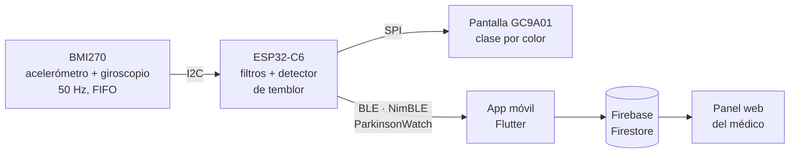
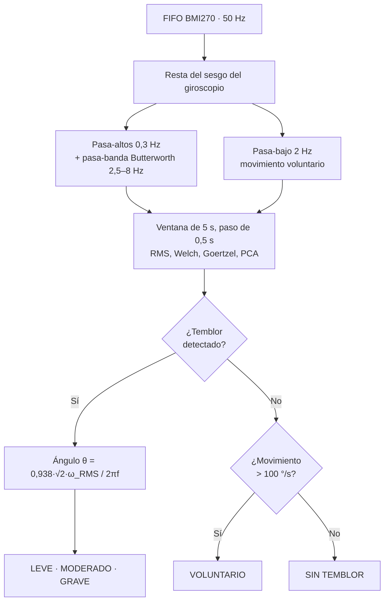

# EMKIWEAR – Firmware del reloj para monitoreo de temblor parkinsoniano

Firmware para **ESP32-C6** de EMKIWEAR, un reloj que detecta y clasifica en tiempo real el temblor de reposo asociado a la enfermedad de Parkinson. El reloj lee una IMU **BMI270** a 50 Hz, analiza la señal en el propio microcontrolador y muestra la clase en una pantalla redonda (*Sin temblor*, *Leve*, *Moderado*, *Grave* o *Movimiento voluntario*). Además, envía los resultados y la señal cruda por **Bluetooth Low Energy** a la aplicación móvil, que los sincroniza con Firebase para que el médico los consulte en el panel web.

> Proyecto de trabajo de grado de Ingeniería Electrónica, Pontificia Universidad Javeriana (Bogotá, 2026).
> Este repositorio contiene **solo el firmware**; la aplicación móvil (Flutter) y el panel web del médico son parte del sistema, pero no están aquí.

---

## Contenido

- [Arquitectura del sistema](#arquitectura-del-sistema)
- [Hardware y conexiones](#hardware-y-conexiones)
- [Compilar y programar](#compilar-y-programar)
- [Funcionamiento](#funcionamiento)
- [Algoritmo de detección y clasificación](#algoritmo-de-detección-y-clasificación)
- [Protocolo BLE](#protocolo-ble)
- [Estructura del repositorio](#estructura-del-repositorio)
- [Ajustes frecuentes](#ajustes-frecuentes)
- [Resultados de las pruebas](#resultados-de-las-pruebas)
- [Autoras](#autoras)

---

## Arquitectura del sistema



Toda la clasificación ocurre en el reloj. La app recibe la clase ya calculada (característica `STATUS`), la severidad (`SEV`), resúmenes cada 5 min (`SUMMARY`) y, si se suscribe, la señal cruda para análisis en MATLAB (`RAWFIFO`).

---

## Hardware y conexiones

| Componente | Detalle |
|---|---|
| Microcontrolador | ESP32-C6 (RISC-V, 160 MHz, flash de 2 MB) |
| IMU | Bosch BMI270, 6 ejes, ±4 g y ±500 °/s, ODR de 50 Hz |
| Pantalla | GC9A01 redonda de 1,28" (240×240, TFT IPS) por SPI |
| Batería | LiPo de 3,7 V y 500 mAh, carga por USB-C |
| Botón | Uno solo, enciende y apaga la pantalla |

### Pines

| Señal | GPIO ESP32-C6 | Notas |
|---|---|---|
| BMI270 SDA | 6 | I2C, 100 kHz, dirección 0x68 |
| BMI270 SCL | 7 | |
| Pantalla SCL (SCLK) | 18 | SPI |
| Pantalla SDA (MOSI) | 15 | Pin de *strapping*: si el arranque es inestable, moverlo |
| Pantalla RES | 3 | |
| Pantalla DC | 2 | |
| Pantalla CS | 4 | Pin de *strapping* (en alto en reposo) |
| Pantalla BLK | 14 | Retroiluminación |
| Botón de pantalla | 8 | A GND, *pull-up* interno. Pin de *strapping*: **no presionarlo al encender** |
| Detección de carga | 1 | Nodo del LED del cargador. **Verificar con multímetro que no supere 3,3 V** |

Las alimentaciones van a 3V3 y todas las tierras deben ser comunes.

---

## Compilar y programar

### Requisitos

- [ESP-IDF **v5.4.4**](https://docs.espressif.com/projects/esp-idf/en/v5.4.4/esp32c6/get-started/index.html) (el proyecto se generó con esa versión).
- Conexión a internet en la primera compilación: `idf.py` descarga el componente `espressif/esp_lcd_gc9a01` (versión fijada en `dependencies.lock`).

### Pasos

Desde la terminal de ESP-IDF (en Windows, la ventana *ESP-IDF 5.4 CMD*):

```bash
git clone https://github.com/yectoprogirls-debug/EMKIWEAR.git
cd EMKIWEAR
idf.py set-target esp32c6     # solo la primera vez
idf.py build
idf.py -p COM3 flash monitor  # cambiar COM3 por el puerto de la placa
```

En Linux o macOS el puerto suele ser `/dev/ttyACM0` o `/dev/ttyUSB0`. Para salir del monitor: `Ctrl + ]`.

> `sdkconfig` está incluido en el repositorio: ya tiene NimBLE activado, MTU preferido de 256 y la consola por USB-Serial-JTAG. No es necesario abrir `menuconfig`.

---

## Funcionamiento

1. **Arranque.** Inicializa NVS, carga los resúmenes guardados, hace un autotest de colores de la pantalla y empieza a anunciarse por BLE como **`ParkinsonWatch`**.
2. **Calibración (~3 s).** Estima el sesgo del giroscopio con 150 muestras. **El reloj debe estar quieto, apoyado en la mesa**, al encenderlo.
3. **Calentamiento (~3 s).** Mientras se llena la primera ventana de 5 s, la pantalla muestra *ANALIZANDO* en gris.
4. **Monitoreo continuo.** Cada 0,5 s actualiza la clase en pantalla y por BLE:

   | Clase | Color de pantalla |
   |---|---|
   | Sin temblor | Verde |
   | Leve | Amarillo |
   | Moderado | Naranja |
   | Grave | Rojo |
   | Movimiento voluntario | Azul |

5. **Resúmenes.** Cada 5 min cierra un resumen (tiempo con temblor, episodios, amplitud y frecuencia medias, conteo por clase). Lo guarda en NVS (hasta 48 resúmenes, unas 4 h) y lo reenvía a la app hasta que esta confirme la recepción.
6. **Botón (GPIO8).** Enciende o apaga la pantalla; el análisis sigue funcionando con la pantalla apagada.
7. **Carga.** Mientras el LED del cargador está encendido se detiene la transmisión BLE; el análisis y la pantalla continúan.

Por el puerto serie se imprime un CSV con la señal (`t_s,ax_g,…,roll_deg,pitch_deg`) y una línea de diagnóstico del detector cada 0,5 s.

---

## Algoritmo de detección y clasificación



**Detección.** Se considera temblor parkinsoniano cuando, en la ventana de 5 s:

- el ritmo es estable (dispersión espectral σ<sub>f</sub> < 0,40 Hz) y la mayor parte de la energía está en la banda (p<sub>rel</sub> > 60 %), votado por al menos 2 ejes del giroscopio (**ruta 1**); o
- hay un temblor de gran amplitud concentrado en un solo eje, detectado por PCA (**ruta 2**); o
- hay un temblor leve en un solo eje con poca energía voluntaria (**ruta 3**);
- y además la energía voluntaria de 1–2,5 Hz es baja (v<sub>110</sub> < 30 %) y el movimiento es coherente con una rotación de la muñeca (descarta vibraciones externas).

**Severidad.** Solo si hay temblor detectado, se gradúa por la amplitud angular estimada θ, con la constante k = 0,938 calibrada con un robot UR10:

| Clase | Ángulo θ | Desplazamiento aprox. de los dedos* |
|---|---|---|
| Leve | < 1,5° | < 0,8 cm |
| Moderado | 1,5° – 4,5° | 0,8 – 2,4 cm |
| Grave | ≥ 4,5° | ≥ 2,4 cm |

\* d = 2 · 15 cm · θ (solo informativo).

Los filtros se diseñaron y validaron en MATLAB/SciPy con actividades cotidianas y 17 configuraciones del robot entre 3 y 7 Hz. Sus coeficientes están en `main/emkiwear_filtros_coef.h`.

---

## Protocolo BLE

Servicio primario: **`7A9B0001-2D4E-4E6F-8A1B-0C2D3E4F5061`**. Todas las estructuras son *little-endian*. La descripción completa, campo por campo, está en `main/ble_stream.h`.

| Característica | UUID | Propiedades | Frecuencia | Contenido |
|---|---|---|---|---|
| SAMPLE | `7A9B0002-…` | Notify, Read | ~25 Hz | Roll, pitch, aceleración lineal, \|giro\|, amplitud en banda (14 B) |
| STATUS | `7A9B0003-…` | Notify, Read | ~2 Hz | Clase, flags, frecuencia dominante, amplitud, duración del episodio (14 B) |
| CMD | `7A9B0004-…` | Write, Notify, Read | — | Comandos (ver abajo) |
| EXT | `7A9B0005-…` | Notify, Read | ~2 Hz | Rama del acelerómetro, relación accel/giro, flag rotacional (12 B) |
| SUMMARY | `7A9B0006-…` | Notify, Read | Cada 5 min | Resumen `hs_record_t` (36 B), con reenvío hasta confirmar |
| RAW | `7A9B0007-…` | Notify, Read | ~50 Hz | IMU 6 ejes en unidades físicas (16 B) |
| RAWFIFO | `7A9B0008-…` | Notify | Lotes | Muestras crudas de la FIFO con número de secuencia (hasta 19 por paquete con MTU 247) |
| SEV | `7A9B000A-…` | Notify, Read | ~2 Hz | Ángulo θ (°·100) y desplazamiento (mm) (8 B) |

La clase va en los bits 3–5 del campo `flags` de STATUS: `(flags >> 3) & 0x07` → 0 Sin temblor, 1 Leve, 2 Moderado, 3 Grave, 4 Voluntario. El bit 6 indica *analizando*.

### Comandos (característica CMD)

| Bytes | Acción |
|---|---|
| `0x00` / `0x01` | Pausar / reanudar SAMPLE |
| `0x02` / `0x03` | Pausar / reanudar RAW |
| `0x10` + uint32 | Sincronizar la hora UNIX (s) |
| `0x20` + uint32 | Confirmar los resúmenes recibidos hasta `seq` |
| `0x30` | Pedir INFO: `FW=…;ODR=…;ACC_RANGE_G=…;GYR_RANGE_DPS=…;LSB2MS2=…;LSB2DPS=…` |

Versión de firmware actual: **2.4.0** (`BLE_FW_VERSION` en `main/ble_stream.c`).

---

## Estructura del repositorio

```
EMKIWEAR/
├── CMakeLists.txt              Proyecto ESP-IDF
├── sdkconfig                   Configuración (ESP32-C6, NimBLE, consola USB)
├── dependencies.lock           Versión fijada de esp_lcd_gc9a01
├── components/
│   └── bmi270_api/             Driver oficial de Bosch (BMI2 / BMI270)
└── main/
    ├── main.c                  Arranque: NVS, pantalla, botón, carga, BLE y tarea de adquisición
    ├── test_bmi270.c/.h        Tarea principal: lee la FIFO, calibra el sesgo y alimenta el detector
    ├── bmi270_esp32.c/.h       Capa I2C del BMI270 y lectura de la FIFO sin pérdidas
    ├── signal_proc.c/.h        Biquads/SOS, filtro complementario y estimación del sesgo
    ├── emkiwear_filtros_coef.h Coeficientes de los filtros y umbrales del detector
    ├── tremor.c/.h             Detector de temblor y clasificación de severidad
    ├── hourly_summary.c/.h     Resúmenes cada 5 min con almacenamiento en NVS
    ├── ble_stream.c/.h         Servidor GATT (NimBLE) y protocolo con la app
    ├── display.c/.h            Pantalla GC9A01: cara del reloj por clase
    ├── display_gfx.c/.h        Dibujo en framebuffer RGB565 (texto 5×7)
    ├── buttons.c/.h            Botón de encendido/apagado de la pantalla
    └── charge.c/.h             Detección de carga: pausa el BLE al cargar
```

---

## Ajustes frecuentes

| Qué cambiar | Dónde |
|---|---|
| Umbrales de severidad (1,5° y 4,5°) | `EMK_SEV_LEVE_MAX_DEG`, `EMK_SEV_MODERADO_MAX_DEG` en `main/emkiwear_filtros_coef.h` |
| Constante de calibración k | `EMK_K_CAL` en `main/emkiwear_filtros_coef.h` |
| Umbrales de detección (σ<sub>f</sub>, p<sub>rel</sub>, v<sub>110</sub>) | `EMK_UMBRAL_*` en `main/emkiwear_filtros_coef.h` |
| Ventana, paso e histéresis | `WIN_SEC`, `HOP_SEC`, `DEBOUNCE_HOPS` en `main/tremor.c` |
| Periodo de los resúmenes (5 min) | `HS_PERIOD_S` en `main/hourly_summary.c` (bajarlo a 60 s para pruebas) |
| Pines de la pantalla | `PIN_*` en `main/display.c` |
| Pines del BMI270 | `BMI270_SDA_GPIO`, `BMI270_SCL_GPIO` en `main/bmi270_esp32.c` |
| Nivel del LED de carga | `CHARGE_ACTIVE_LEVEL` en `main/charge.h` |

Si se cambian los umbrales del firmware, hay que actualizar también la app y el panel web, para que muestren los mismos criterios.

---

## Resultados de las pruebas

Resumen de las pruebas con voluntarios sanos del trabajo de grado (caracterización técnica, **no** validación clínica):

| Prueba | Resultado |
|---|---|
| Actividades de la vida diaria (6 voluntarios, 204 pruebas) | 0 % de falsos positivos de temblor; coincidencia reloj–app del 97,1 % |
| Temblor emulado (leve → moderado → grave) | Clase igual al nivel emulado en el 92,9 % de las lecturas; coherencia clase–ángulo del 100 % |
| Frecuencia dominante en la emulación | Siempre dentro de la banda de 2,5–8 Hz |
| Transiciones | Confirmación del episodio en 2–3 s; regreso a *Sin temblor* en ≤ 2 s |
| Consumo en operación normal | 99,9 mA → autonomía estimada de 4,0–5,0 h con la batería de 500 mAh (requisito: ≥ 3 h) |

---

## Autoras

- María Fernanda Tafur Rosero
- Karen Daniela Gámez Peña
- Karen Natalia Ballén Sierra

Dirección: Catalina Alvarado Rojas (directora) y Camilo Alberto Otálora Sánchez (codirector).
Pontificia Universidad Javeriana – Facultad de Ingeniería, Bogotá, 2026.

El driver del BMI270 en `components/bmi270_api` es de Bosch Sensortec y conserva su licencia original (BSD-3-Clause).
